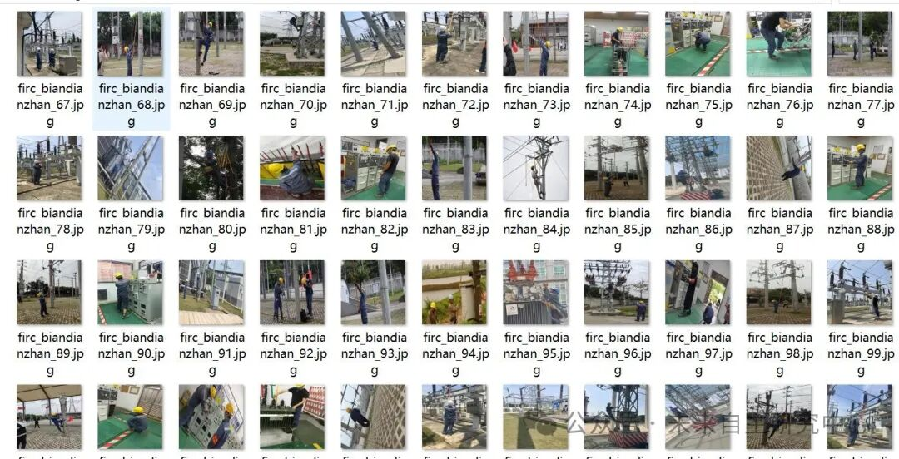
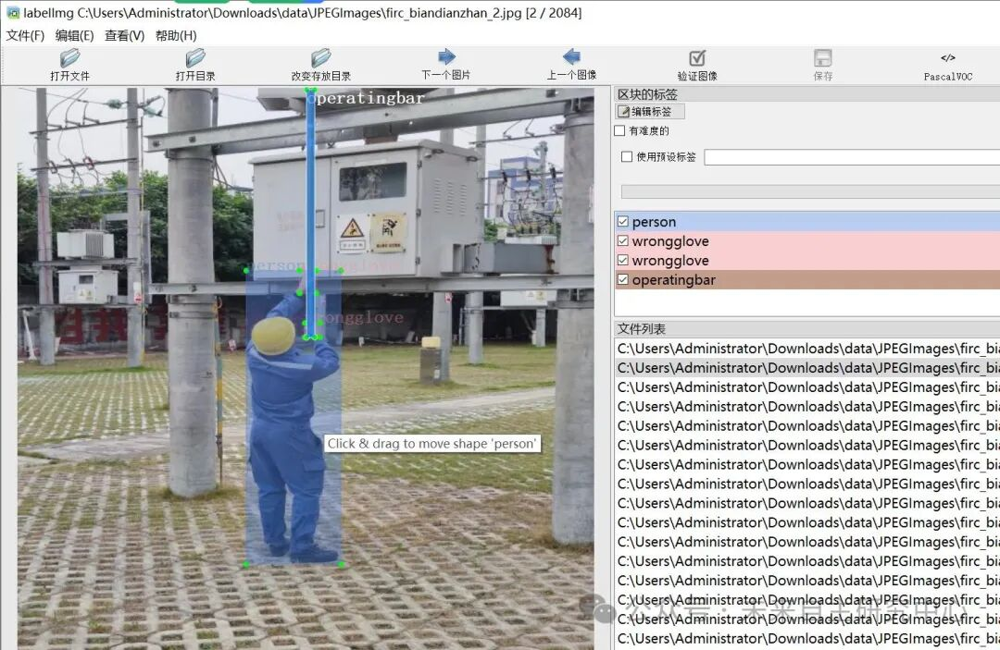

# Dataset for Inspection of Power Scenario Substation Insulation Glove Wearing Standards in VOC+YOLO format with 2084 images across 6 categories

Dataset format: Pascal VOC format + YOLO format (txt file without split path, only containing jpg images and corresponding VOC format xml files and yolo format txt files)

Number of images (number of jpg files): 2084

Number of annotations (number of xml files): 2084

Number of annotations (number of txt files): 2084

Label count: 6

Tags: ["badge", "glove", "operatingbar", "person", "powerchecker", "wrongglove"]

Number of boxes labeled in each category:

Badge Frame Count = 646

Glove frame count = 1494

Operating bar frame count = 740

Person Frames = 3839

Powerchecker Frame Count = 631

WRONGGLOVER Frame Count = 4124

Total frame count: 11474

Using labelImg:

Annotation rules: Draw a rectangle around the category.

Important Notice: No

Special : This dataset does not guarantee the accuracy or precision of the trained models or weight files. The dataset is provided with accurate and reasonable annotations only.

Image Preview:

Annotation example:

## Payment

Here is a pay link on Stripe ( https://buy.stripe.com/3cs8yP7sY87d0vu9AB ). Please contact me lonlonago@foxmail.com after funding $89, and I will send you a complete data files , thank you!

